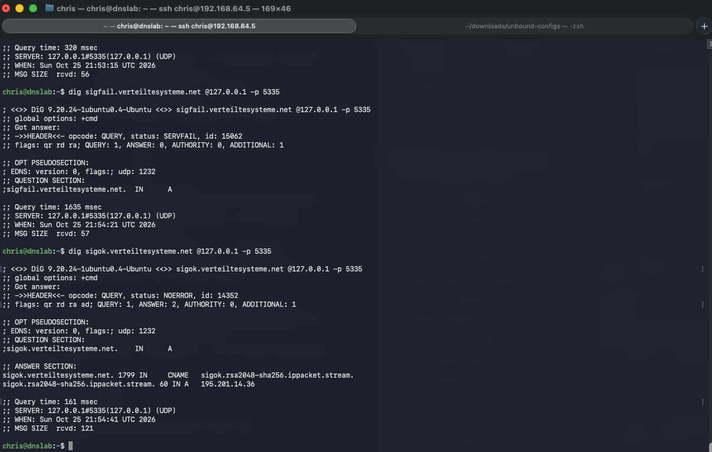
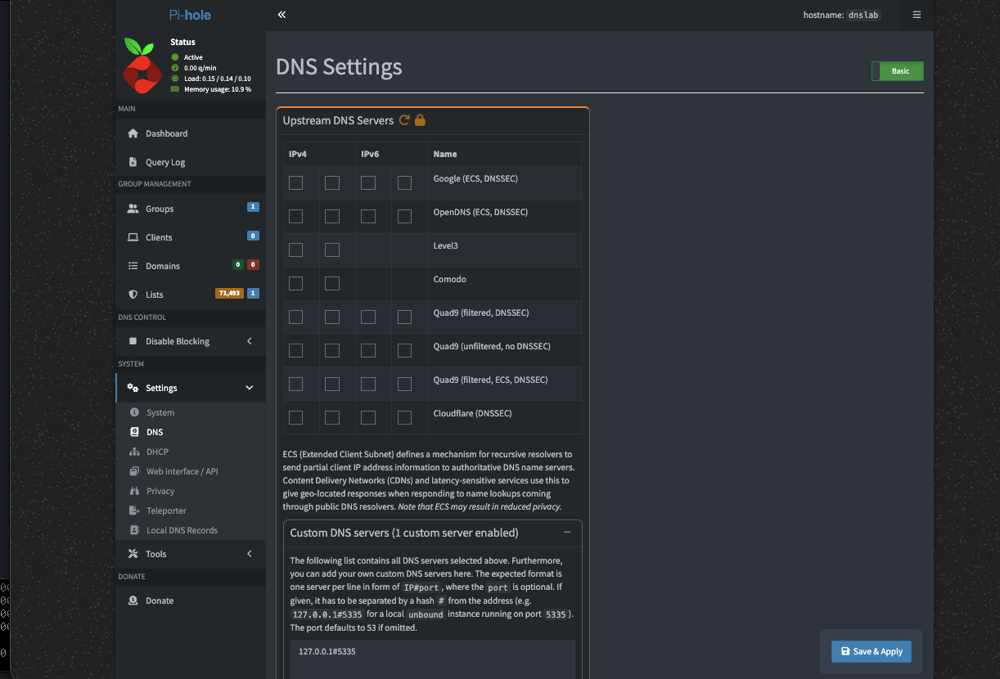
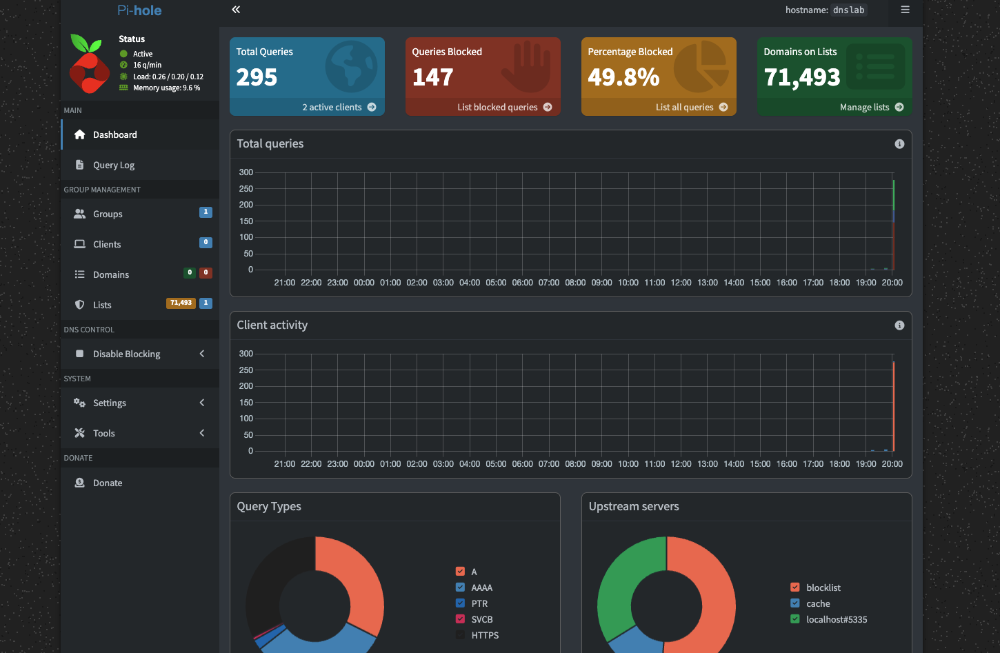
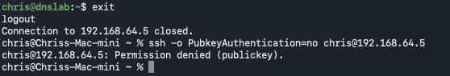

# Pi-hole + Unbound DNS Lab

A home lab DNS server that blocks ads and trackers for any device pointed at it, and does its own name lookups instead of sending every query to a public DNS provider. It runs in a small Ubuntu Server VM on a Mac mini.

I built it to practice things an IT support or junior sysadmin role touches every day: installing and securing a Linux server, DNS, Docker, SSH, and writing down what I did so someone else can repeat it.

## How it works

```
phone / laptop
      |  DNS query, port 53
      v
Pi-hole (Docker, host networking)     blocks ads and trackers using blocklists
      |  everything not blocked goes to 127.0.0.1:5335
      v
Unbound (installed on the VM)         recursive resolver that validates DNSSEC
      |
      v
root and authoritative DNS servers
```

Pi-hole answers clients and filters. Unbound does the real lookups itself, starting from the root servers, so no single upstream provider sees every query. Unbound listens only on the loopback address, so other devices on the network cannot query it directly.

## What it runs on

| Item | Value |
| --- | --- |
| Host | Mac mini (Apple silicon), UTM virtual machine |
| VM | 2 CPU cores, 4 GB RAM, 20 GB disk, bridged network |
| OS | Ubuntu Server 26.04 LTS (arm64) |
| Pi-hole | Docker image tag 2026.10.0 (Core v6.5, FTL v6.8, Web v6.6.1) |
| Unbound | 1.24.2 from Ubuntu's repositories |
| Docker | Ubuntu packages `docker.io` and `docker-compose-v2` |

## Build steps

1. **Install Ubuntu Server** in UTM with OpenSSH server selected and a plain username and hostname (`dnslab`). Skip the optional snaps. The Docker snap runs in a sandbox that causes volume problems, so Docker comes from apt instead.
2. **Use bridged networking.** UTM's default Shared mode puts the VM on a private address that other devices cannot reach. Bridged gives it an address on the home network.
3. **Set up key-based SSH.** Create a key on the Mac with `ssh-keygen -t ed25519`, copy it with `ssh-copy-id`, then turn off password logins with [`sshd_config.d/10-no-passwords.conf`](sshd_config.d/10-no-passwords.conf) in `/etc/ssh/sshd_config.d/`. Check the result with `sudo sshd -t`, `sudo systemctl restart ssh`, and `sudo sshd -T | grep passwordauthentication`.
4. **Install packages.**
   ```
   sudo apt update && sudo apt upgrade -y
   sudo apt install -y unbound docker.io docker-compose-v2 bind9-dnsutils
   sudo usermod -aG docker $USER
   ```
5. **Configure Unbound.** Copy [`unbound/pi-hole.conf`](unbound/pi-hole.conf) to `/etc/unbound/unbound.conf.d/`, then run `sudo unbound-checkconf` and `sudo systemctl restart unbound`.
6. **Free port 53.** Ubuntu's built-in resolver listens on port 53, which Pi-hole needs. Copy [`resolved.conf.d/pihole.conf`](resolved.conf.d/pihole.conf) to `/etc/systemd/resolved.conf.d/`, run `sudo systemctl restart systemd-resolved`, then `sudo ln -sf /run/systemd/resolve/resolv.conf /etc/resolv.conf` so the VM can still resolve names.
7. **Start Pi-hole.** Copy `.env.example` to `.env`, set a password, run `chmod 600 .env`, then `docker compose up -d`. The compose file is [`docker-compose.yml`](docker-compose.yml). Host networking lets Pi-hole reach Unbound at `127.0.0.1#5335`.
8. **Point a device at it.** Set the device's DNS manually to the VM's address.

## Checking that it works

Unbound answers on its own port, and it validates DNSSEC. A deliberately broken signature should fail, and a good one should pass with the `ad` (authenticated data) flag:

```
dig pi-hole.net @127.0.0.1 -p 5335                     # NOERROR
dig sigfail.verteiltesysteme.net @127.0.0.1 -p 5335    # SERVFAIL, bad signature rejected
dig sigok.verteiltesysteme.net @127.0.0.1 -p 5335      # NOERROR with the ad flag
```



Pi-hole should have Unbound as its only upstream, so nothing bypasses it:



With a phone's Wi-Fi DNS set to the VM, the dashboard fills in with queries and blocks. The upstream chart shows lookups coming from the blocklist, the cache, and `localhost#5335`, which is Unbound:



Password SSH logins are rejected, so only the key works:



## Things I ran into

- **Port 53 conflict.** Pi-hole will not start while Ubuntu's own resolver holds port 53. The drop-in file above turns off its stub listener, and the `resolv.conf` link keeps the VM able to look up names afterward.
- **A broken Unbound config from an earlier build.** The config I first saved had a malformed `access-control` line with no action, and Unbound listened on every interface. I rebuilt it to listen only on `127.0.0.1` and checked it with `unbound-checkconf` before restarting.
- **Shared network mode.** The VM was unreachable from other devices until I switched UTM to Bridged.

## What is not in this repo

The real `.env` file and the `etc-pihole/` data folder stay out, because they hold the Pi-hole password hash and query history. `.env.example` shows the format with a placeholder.
